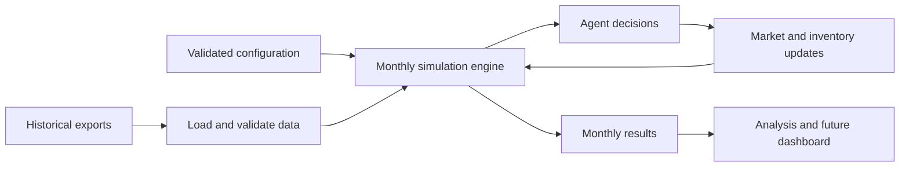

# Architecture

## Existing package

The installable distribution is `soybean-crush-simulator`; the Python import
package is `soybean_sim`. Source code lives under `src/soybean_sim/`, and Hatchling
builds the package. The `soybean-sim` entry point invokes the Typer application.

| Component | Responsibility |
| --- | --- |
| `__init__.py` | Read the installed package version |
| `models/` | Shared enums and validated balances, prices, inventories, and simulation inputs |
| `config.py` | Immutable run settings and safe YAML loading |
| `cli.py` | Version display, configuration validation, and terminal errors |
| `agents/` | Producer, crusher, and trader decisions |
| `market/` | Prices, inventories, processing flows, and trade |
| `simulation/` | Monthly run loop, random generator, and scenario effects |
| `data/` inside the package | Local historical loaders, record selection, inventory initialization, and input assembly |

Root `configs/` contains a baseline YAML example. Root `data/` is for local datasets
and derived files, ignored by Git except for its README. Unit tests cover enums,
configuration, and file errors; integration tests exercise the CLI and input preparation.

Configuration loading uses `yaml.safe_load` and Pydantic. `ConfigurationError`
reports file and field context; the CLI converts it to stderr output and a nonzero
exit code. Domain and configuration code do not depend on CLI or dashboard code.

The USDA CSV loader lives in `data/usda/`: `mappings.py` holds verified identifiers
and required columns, `parsing.py` validates observation metadata and quantities,
and `loader.py` reads, filters, and groups CSV rows into `MarketBalance` records.
`errors.py` defines the common data error and file, format, and observation categories.
The package's `__init__.py` preserves the public `load_usda_psd_csv` and
`USDADataError` imports from `soybean_sim.data.usda`.

`data/world_bank/` follows the same focused layout: `mappings.py` describes the
verified source series and layout, `parsing.py` validates months and prices, and
`loader.py` reads and groups XLSX observations. Its public package exposes
`load_world_bank_prices` and `WorldBankDataError`. Both historical loaders return
records independently; `data/builder.py` combines their output into simulation inputs.

## Historical data selection

`data/selection.py` selects already validated records from either loader, without
reading files or constructing simulation state. Its public API is available from
`soybean_sim.data`:

```python
from datetime import date

from soybean_sim.data import select_market_data
from soybean_sim.models import Commodity, Region

# balances and prices are model instances already returned by the loaders.
selected_balances, selected_prices = select_market_data(
    balances,
    prices,
    marketing_year="2020/21",
    price_month=date(2021, 1, 1),
    regions=[Region.BRAZIL, Region.ARGENTINA],
    commodities=[Commodity.SOYBEANS, Commodity.SOYBEAN_MEAL],
)
```

The result contains two tuples: balances sorted by region and commodity, and
prices sorted by commodity. Every explicitly requested region/commodity pair is
required, with one global price per commodity. Missing requested records or
conflicts produce `MarketDataSelectionError`, a `ValueError` subclass exported
from the same package. Missing identifiers are listed deterministically.

The marketing-year selector is a nonempty string label, trimmed like the model's
field; it need not be a four-digit year. The price month must independently be a
first-of-month `date`, not a string or datetime. Region and commodity collections
must be nonempty; enum members and their string identifiers are accepted, and
repeated requests count once. Bare strings are not identifier collections.

Only matching records participate in duplicate checks. Equal records count once;
different quantities, prices, or price-source labels for the same selected key
are conflicts. Existing model instances and unknown quantities remain unchanged.
Completeness means record presence, not that every quantity is known. There is
no fallback to another period, annual-to-monthly allocation, inventory creation,
or `SimulationInput` assembly. Any valid iterable, including a one-pass generator,
can supply the records or requested identifiers.

## Initial inventory builder

`data/inventory.py` converts selected balances into inventories through the public
data package API:

```python
from soybean_sim.data import build_initial_inventories

inventories = build_initial_inventories(selected_balances)
```

The result is a tuple sorted by region and commodity, with one inventory per
balance. `beginning_stocks_tonnes` becomes `quantity_tonnes` without changing units
or source records. Known zero stocks are valid. Missing beginning stocks and any
repeated region/commodity pair, even an identical record or another marketing
year, produce `InventoryInitializationError` from the same public package.
Empty input returns an empty tuple.

The builder does not select periods, adjust stocks to the price month, or assemble
`SimulationInput`. See the [inventory timing assumption](assumptions.md#initial-inventory-reference).

## Simulation input assembly

`build_simulation_input()` is exported from `soybean_sim.data` and composes three
existing stages in `data/builder.py`:

1. `select_market_data()` selects complete regional balances for an explicit
   marketing-year label and global prices for an independent calendar month.
2. `build_initial_inventories()` maps selected beginning stocks into inventories.
3. `SimulationInput` validates and stores the balances, prices, and inventories.

Selection and inventory errors propagate as `MarketDataSelectionError` and
`InventoryInitializationError`; Pydantic enforces the final model's invariants.
The builder adds no separate validation policy. Results retain the components'
deterministic ordering and leave source collections unchanged.

This is baseline initialization, not a reconstruction of inventories on the
selected price month. The builder reads no files, allocates no monthly flows,
applies no seasonal or stock adjustments, and does not execute a simulation.
See the [loader-to-input example](data-sources.md#building-simulation-inputs)
and [inventory timing assumption](assumptions.md#initial-inventory-reference).

## Market input models

The following Pydantic models are implemented in `soybean_sim.models` for use by
future ingestion code, the simulation engine, and agents. `models/enums.py` defines
the enums, `models/market.py` contains market records and shared validation types,
and `models/simulation.py` defines `SimulationInput`.

Models reject extra fields and are immutable; collection fields in `SimulationInput` use tuples.

| Model | Fields and purpose |
| --- | --- |
| `MarketBalance` | Region, commodity, original `marketing_year` label, production, imports, exports, domestic consumption, beginning/ending stocks, and optional crush volume |
| `CommodityPrice` | Commodity, `month`, positive `price_usd_per_tonne`, and nonempty `data_source` label |
| `Inventory` | Region, commodity, and known nonnegative `quantity_tonnes` at initialization |
| `SimulationInput` | Nonempty `balances`, `prices`, and `inventories` collections describing an initial state |

All quantity fields end in `_tonnes` and use metric tons, never thousands of tons.

`marketing_year` preserves the source's nonempty string label, without inferring
dates or a calendar-year boundary. JSON uses `YYYY-MM-01`.

## Planned simulation workflow

The engine will combine producer, crusher, and trader agents with regional market
state. Each step will represent one month. The configured step count is already
validated, but no scheduling or calendar behavior exists yet.

A tentative workflow is:

1. Load and validate configuration and prepared historical inputs.
2. Initialize regional state and a random generator from the configured seed.
3. For each month, apply scenario effects, collect agent decisions, reconcile
   feasible production, processing, and trade, then update prices and inventories.
4. Record monthly results for analysis and future visualization.

The ordering within a month and the economic rules remain open. The following
flow beyond configuration validation is planned:



Data ingestion will provide prepared inputs rather than performing downloads
inside agent decisions. The engine will own run state and compose agents and
market logic, avoiding global mutable state. CLI and future Streamlit code will
call the same Python interfaces; simulation logic will not render UI elements or
read terminal arguments.

## Python API

The existing API supports configuration loading, shared identifiers, and the market
input models described above:

```python
from soybean_sim.config import ConfigurationError, SimulationConfig, load_config
from soybean_sim.models import Commodity, Region

config = load_config("configs/baseline.yaml")
print(config.regions)
```

`load_config(path: str | Path) -> SimulationConfig` returns validated settings
or raises `ConfigurationError`. `Region` and `Commodity` expose the supported
string identifiers. The package also exposes `soybean_sim.__version__`.

The planned simulation API will accept validated configuration and prepared data,
run the monthly model, and return results without depending on the CLI or UI.
Function names, state types, and the results representation are not decided.
There is no callable simulation API yet.

See [assumptions](assumptions.md) for economic decisions and
[data sources](data-sources.md) for input preparation.
