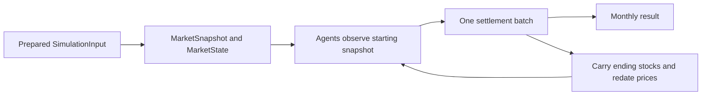

# Architecture

## Existing package

The installable distribution is `soybean-crush-simulator`; the Python import
package is `soybean_sim`. Source code lives under `src/soybean_sim/`, and Hatchling
builds the package. The `soybean-sim` entry point invokes the Typer application.

| Component | Responsibility |
| --- | --- |
| `__init__.py` | Read the installed package version |
| `models/` | Shared enums, market records, simulation inputs, and monthly observations |
| `config.py` | Immutable run settings and safe YAML loading |
| `cli.py` | Version display, configuration validation, and terminal errors |
| `agents/` | Agent contracts and deterministic Producer, Crusher, and Trader intentions |
| `market/` | Immutable market state, physical crushing settlement, and deferred trade results |
| `simulation/` | Deterministic monthly orchestration, calendar advancement, and frozen histories |
| `data/` inside the package | Local historical loaders, record selection, inventory initialization, and input assembly |

Root `configs/` contains a baseline YAML example. Root `data/` is for local datasets
and derived files, ignored by Git except for its README. Unit tests cover enums,
configuration, and file errors; integration tests exercise the CLI and input preparation.

Configuration loading uses `yaml.safe_load` and Pydantic. `ConfigurationError`
reports file and field context; the CLI converts it to stderr output and a nonzero
exit code. Domain and configuration code do not depend on CLI or dashboard code.

The USDA CSV loader lives in `data/usda/`: `mappings.py` holds verified identifiers
and required columns, `parsing.py` validates observation metadata and quantities,
and `loader.py` reads, filters, and groups CSV rows into `MarketBalance` records.
`errors.py` defines the common data error and file, format, and observation categories.
The package's `__init__.py` preserves the public `load_usda_psd_csv` and
`USDADataError` imports from `soybean_sim.data.usda`.

`data/world_bank/` follows the same focused layout: `mappings.py` describes the
verified source series and layout, `parsing.py` validates months and prices, and
`loader.py` reads and groups XLSX observations. Its public package exposes
`load_world_bank_prices` and `WorldBankDataError`. Both historical loaders return
records independently; `data/builder.py` combines their output into simulation inputs.

## Historical data selection

`data/selection.py` selects already validated records from either loader, without
reading files or constructing simulation state. Its public API is available from
`soybean_sim.data`:

```python
from datetime import date

from soybean_sim.data import select_market_data
from soybean_sim.models import Commodity, Region

# balances and prices are model instances already returned by the loaders.
selected_balances, selected_prices = select_market_data(
    balances,
    prices,
    marketing_year="2020/21",
    price_month=date(2021, 1, 1),
    regions=[Region.BRAZIL, Region.ARGENTINA],
    commodities=[Commodity.SOYBEANS, Commodity.SOYBEAN_MEAL],
)
```

The result contains two tuples: balances sorted by region and commodity, and
prices sorted by commodity. Every explicitly requested region/commodity pair is
required, with one global price per commodity. Missing requested records or
conflicts produce `MarketDataSelectionError`, a `ValueError` subclass exported
from the same package. Missing identifiers are listed deterministically.

The marketing-year selector is a nonempty string label, trimmed like the model's
field; it need not be a four-digit year. The price month must independently be a
first-of-month `date`, not a string or datetime. Region and commodity collections
must be nonempty; enum members and their string identifiers are accepted, and
repeated requests count once. Bare strings are not identifier collections.

Only matching records participate in duplicate checks. Equal records count once;
different quantities, prices, or price-source labels for the same selected key
are conflicts. Existing model instances and unknown quantities remain unchanged.
Completeness means record presence, not that every quantity is known. There is
no fallback to another period, annual-to-monthly allocation, inventory creation,
or `SimulationInput` assembly. Any valid iterable, including a one-pass generator,
can supply the records or requested identifiers.

## Initial inventory builder

`data/inventory.py` converts selected balances into inventories through the public
data package API:

```python
from soybean_sim.data import build_initial_inventories

inventories = build_initial_inventories(selected_balances)
```

The result is a tuple sorted by region and commodity, with one inventory per
balance. `beginning_stocks_tonnes` becomes `quantity_tonnes` without changing units
or source records. Known zero stocks are valid. Missing beginning stocks and any
repeated region/commodity pair, even an identical record or another marketing
year, produce `InventoryInitializationError` from the same public package.
Empty input returns an empty tuple.

The builder does not select periods, adjust stocks to the price month, or assemble
`SimulationInput`. See the [inventory timing assumption](assumptions.md#initial-inventory-reference).

## Simulation input assembly

`build_simulation_input()` is exported from `soybean_sim.data` and composes three
existing stages in `data/builder.py`:

1. `select_market_data()` selects complete regional balances for an explicit
   marketing-year label and global prices for an independent calendar month.
2. `build_initial_inventories()` maps selected beginning stocks into inventories.
3. `SimulationInput` validates and stores the balances, prices, and inventories.

Selection and inventory errors propagate as `MarketDataSelectionError` and
`InventoryInitializationError`; Pydantic enforces the final model's invariants.
The builder adds no separate validation policy. Results retain the components'
deterministic ordering and leave source collections unchanged.

This is baseline initialization, not a reconstruction of inventories on the
selected price month. The builder reads no files, allocates no monthly flows,
applies no seasonal or stock adjustments, and does not execute a simulation.
See the [loader-to-input example](data-sources.md#building-simulation-inputs)
and [inventory timing assumption](assumptions.md#initial-inventory-reference).

## Market input models

The following Pydantic models are implemented in `soybean_sim.models` for use by
future ingestion code, the simulation engine, and agents. `models/enums.py` defines
the enums, `models/market.py` contains market records and shared validation types,
and `models/simulation.py` defines `SimulationInput`.

Models reject extra fields and are immutable; collection fields in `SimulationInput` use tuples.

| Model | Fields and purpose |
| --- | --- |
| `MarketBalance` | Region, commodity, original `marketing_year` label, production, imports, exports, domestic consumption, beginning/ending stocks, and optional crush volume |
| `CommodityPrice` | Commodity, `month`, positive `price_usd_per_tonne`, and nonempty `data_source` label |
| `Inventory` | Region, commodity, and known nonnegative `quantity_tonnes` at initialization |
| `SimulationInput` | Nonempty `balances`, `prices`, and `inventories` collections describing an initial state |

All quantity fields end in `_tonnes` and use metric tons, never thousands of tons.

`marketing_year` preserves the source's nonempty string label, without inferring
dates or a calendar-year boundary. JSON uses `YYYY-MM-01`.

## Agent observations and decisions

`MarketSnapshot`, exported from `soybean_sim.models` and defined in
`models/snapshot.py`, describes what agents observe at the beginning of a step.
It contains a first-of-month `date`, a nonempty tuple of existing `CommodityPrice`
records, and a tuple of existing `Inventory` records. Non-first-day Python dates,
strings, and datetimes are rejected rather than silently normalized. Prices must
be unique by commodity and match the snapshot month; inventories must be unique
by region and commodity. Empty inventories are allowed and do not imply zero
stock. All records are frozen, and no annual balances are treated as monthly flows.
Prices remain global references, not regional transaction prices.

The public `soybean_sim.agents` API exposes:

- `AgentIdentity`: a frozen `agent_id`, `agent_type`, and `region`. IDs are trimmed,
  nonblank strings assigned by callers; uniqueness across agents will be a future
  engine responsibility. `AgentType` identifies producers, crushers, and traders.
- `AgentDecision`: a frozen agent identity, first-of-month `month`, typed `action`,
  `commodity`, and finite nonnegative `quantity_tonnes`. `DecisionAction` provides
  `OFFER_FOR_SALE`, `PURCHASE`, and `CRUSH`. Every action names a commodity; crushing
  requires soybeans and measures input tonnes. Zero tonnes requests no operation.
- `Agent`: a `Protocol` with a read-only `identity` property and
  `decide(snapshot: MarketSnapshot) -> tuple[AgentDecision, ...]`. Implementations
  need no inheritance and must leave observations unchanged. Returned decisions
  must use that identity and the snapshot month; `()` means abstaining.

For example, given a validated `initial` input from the
[input builder](data-sources.md#building-simulation-inputs), a caller can describe
an observation and an illustrative intention:

```python
from soybean_sim.agents import AgentDecision, AgentIdentity, AgentType, DecisionAction
from soybean_sim.models import Commodity, MarketSnapshot, Region

snapshot = MarketSnapshot(
    month=initial.prices[0].month,
    prices=initial.prices,
    inventories=initial.inventories,
)
identity = AgentIdentity(
    agent_id="producer-br-1", agent_type=AgentType.PRODUCER, region=Region.BRAZIL
)
proposal = AgentDecision(
    agent=identity,
    month=snapshot.month,
    action=DecisionAction.OFFER_FOR_SALE,
    commodity=Commodity.SOYBEANS,
    quantity_tonnes=5,
)
```

Creating `proposal` executes nothing and changes neither stocks nor prices. The
example uses the [baseline beginning-stocks assumption](assumptions.md#initial-inventory-reference);
it does not reconstruct stocks at the selected price month. Identity and decision
models live in `agents/models.py`; the protocol lives in `agents/base.py`.
Settlement checks the market month and identity consistency across decisions.
The engine checks each returned identity against its registered agent. Trade
execution remains future work.

## Producer supply heuristic

`agents/producer.py` implements `Producer`, an aggregate soybean producer for one
region. It satisfies `Agent` structurally and holds a frozen `AgentIdentity` with
`agent_type=PRODUCER` and an explicit frozen `ProducerConfig`. A different role
is rejected at construction. These types and `ProducerDecisionError` are exported
from `soybean_sim.agents`.

The producer divides the snapshot's global soybean price by the configured
`reference_price_usd_per_tonne`, then offers a fraction of its own region's
soybean stock:

| Default price ratio | Supply fraction |
| --- | --- |
| Below 0.90 | 0.20 |
| 0.90 to below 1.10 | 0.50 |
| At least 1.10 | 0.80 |

The reference price is required, positive, finite, and expressed in USD/tonne.
`low_price_ratio` and `high_price_ratio` configure the band boundaries; both are
finite and positive, with the high threshold strictly greater than the low one.
`low_supply_fraction`, `normal_supply_fraction`, and `high_supply_fraction` are
finite fractions in [0, 1], ordered from low to high without decreasing.
These are configurable modeling defaults, not empirically calibrated responses.

Using the producer identity and snapshot from the preceding example:

```python
from soybean_sim.agents import Producer, ProducerConfig

producer = Producer(
    identity=identity,
    config=ProducerConfig(reference_price_usd_per_tonne=400),
)
decisions = producer.decide(snapshot)
```

Each nonempty result contains one `OFFER_FOR_SALE` decision for soybeans, carrying
the producer's identity, the snapshot month, and the unrounded requested tonnes.
Missing soybean prices or regional soybean stocks raise `ProducerDecisionError`
with agent and month context; missing stock is never treated as zero. Known zero
stock returns `()`. A configured zero fraction with positive stock produces a
zero-tonne intention, consistent with the decision contract.

Inventory is treated as available supply for this decision. The heuristic uses
global reference prices and does not model regional transaction prices, crop
growth, harvesting, new production, or annual-to-monthly allocation. Calling
`decide()` is deterministic and does not reserve, subtract, or sell stock; repeated
calls with the same snapshot propose the same offer. Future execution must own
inventory changes and settlement.

## Crusher processing heuristic

`agents/crusher.py` implements one aggregate `Crusher` per region, with a frozen
crusher identity and `CrusherConfig`. It satisfies `Agent` structurally. Import
`Crusher`, `CrusherConfig`, and `CrusherDecisionError` from `soybean_sim.agents`.

The crusher reads all three global commodity prices and calculates USD per tonne
of soybean input:

```text
gross_crush_spread = meal_yield * meal_price + oil_yield * oil_price - soybean_price
net_crush_margin = gross_crush_spread - processing_cost
```

`monthly_capacity_tonnes` is a required positive finite input capacity;
`processing_cost_usd_per_tonne` is required, finite, and nonnegative. The default
`meal_yield_fraction=0.80` and `oil_yield_fraction=0.20` are a simplified modeling
assumption with no losses or by-products. Yields must be finite, nonnegative,
and sum to one within an absolute tolerance of `1e-9`.

| Default net margin (USD/input tonne) | Capacity utilization |
| --- | --- |
| At most 0 | 0% |
| Above 0 and below 30 | 30% |
| From 30 to below 60 | 60% |
| At least 60 | 100% |

The three boundaries are configurable through `low_margin_threshold_usd_per_tonne`,
`high_margin_threshold_usd_per_tonne`, and
`full_utilization_threshold_usd_per_tonne`; they must be finite and strictly
increasing. `low_utilization_fraction`, `medium_utilization_fraction`, and
`high_utilization_fraction` must be finite, nondecreasing, and within [0, 1].

Requested input tonnes are `min(monthly_capacity_tonnes * utilization, regional
soybean inventory)`. Zero returns `()`; otherwise, one `CRUSH` decision identifies
the crusher, snapshot month, soybeans, and requested input tonnes. Missing prices
or regional soybean stocks raise `CrusherDecisionError`, even if processing would
be zero. Arithmetic overflow producing a nonfinite margin also raises this error.

For a snapshot containing all three prices and Brazilian soybean stock:

```python
from soybean_sim.agents import AgentIdentity, AgentType, Crusher, CrusherConfig
from soybean_sim.models import Region

crusher = Crusher(
    identity=AgentIdentity(
        agent_id="crusher-br-1", agent_type=AgentType.CRUSHER, region=Region.BRAZIL
    ),
    config=CrusherConfig(
        monthly_capacity_tonnes=1000, processing_cost_usd_per_tonne=10
    ),
)
decisions = crusher.decide(snapshot)
```

Regional stock is only an upper bound on a potential request, not exclusive
crusher ownership or a reservation. A request executes no processing, deducts no
soybeans, and creates no meal or oil stocks. Producer offers and Crusher requests
are not automatically compatible. The initial assumption is one aggregate
Crusher per region. The settlement layer can allocate several crusher requests
sequentially against regional stocks; actual purchases and cross-agent trade
matching remain future work. The heuristic uses global reference prices, not
regional transaction prices.

## Trader purchase and sale heuristics

`agents/trader.py` implements an aggregate regional `Trader`. Import `Trader`,
`TraderConfig`, and `TraderDecisionError` from `soybean_sim.agents`. The agent
requires a trader-role identity and satisfies `Agent` structurally.

Each market price is divided by its own configured reference price. The same
ratio boundaries apply to soybean purchases and meal/oil sale offers, with
opposite response directions:

| Default market/reference ratio | Soybean purchase fraction | Product sale fraction |
| --- | --- | --- |
| Below 0.90 | 1.00 | 0.20 |
| 0.90 to below 1.10 | 0.50 | 0.50 |
| At least 1.10 | 0.20 | 0.80 |

`TraderConfig` requires positive finite `reference_soybean_price_usd_per_tonne`,
`reference_soybean_meal_price_usd_per_tonne`, and
`reference_soybean_oil_price_usd_per_tonne`, plus a finite nonnegative
`maximum_monthly_purchase_tonnes`. `low_price_ratio` and `high_price_ratio` are
positive, finite, and strictly increasing. `low_purchase_fraction`,
`normal_purchase_fraction`, and `high_purchase_fraction` must be nonincreasing;
`low_sale_fraction`, `normal_sale_fraction`, and `high_sale_fraction` must be
nondecreasing. All fractions are finite and within [0, 1]. These are modeling
defaults rather than calibrated trading rules.

Purchase tonnes equal the monthly purchase limit times the soybean purchase
fraction; regional soybean stock does not limit this demand. Each product's sale
tonnes equal its observed regional stock times the product sale fraction.
Individual offers cannot exceed observed product stock. Zero quantities produce
no decision. All three prices and both regional product inventories are required,
including when capacity, fractions, or stocks are zero; missing observations raise
`TraderDecisionError` with commodity, agent, month, and available region context.

For a snapshot containing those observations:

```python
from soybean_sim.agents import AgentIdentity, AgentType, Trader, TraderConfig
from soybean_sim.models import Region

trader = Trader(
    identity=AgentIdentity(
        agent_id="trader-br-1", agent_type=AgentType.TRADER, region=Region.BRAZIL
    ),
    config=TraderConfig(
        reference_soybean_price_usd_per_tonne=400,
        reference_soybean_meal_price_usd_per_tonne=300,
        reference_soybean_oil_price_usd_per_tonne=1000,
        maximum_monthly_purchase_tonnes=1000,
    ),
)
decisions = trader.decide(snapshot)
```

Results sort by commodity identifier and action identifier: meal sale, oil sale,
then soybean purchase, omitting zero quantities. Decisions retain the trader
identity and snapshot month. Repeated calls leave observations unchanged.

The Trader submits intentions only. Regional product stocks are availability
proxies, not exclusive ownership or reservations. Global reference prices are
not regional transaction prices. No routes, counterparties, destinations,
transport costs, budgets, or cross-border transfers are represented. Future
market clearing must match intentions, allocate shared stocks, prevent
double-counting across all agents, and perform settlement and inventory updates.

## Market state and physical settlement

`market/models.py` defines frozen `MarketState` and `SettlementResult` models plus
`SettlementOutcome`. State contains one `MarketSnapshot`; results distinguish
requested tonnes from executed and unfulfilled tonnes. `market/settlement.py`
provides `settle_decisions()` and `SettlementError`, exported through
`soybean_sim.market`.

Settlement validates a batch, allocates CRUSH requests in ascending agent-ID
order, consumes available regional soybeans, and adds configured meal/oil output
to a new state. It trusts agent capacity decisions. Purchase and sale intentions
remain wholly unexecuted because matching is not implemented. Shared stocks imply
no agent ownership or real Producer-to-Crusher transaction.

See [market settlement](settlement.md) for the API, allocation and validation
rules, numerical tolerances, limitations, and a complete synthetic example.

## Monthly simulation workflow

`simulation/engine.py` exposes `run_simulation()`. It validates the initial state,
duration, regional agent identities, unique IDs, and required crusher configs.
Each month, agents observe one shared starting snapshot in ascending ID order;
the engine collects their decisions and calls settlement once. Ending inventories
carry into the next calendar month. Price values and sources stay constant while
price dates advance. The final state belongs to the last completed month.

`simulation/calendar.py` handles calendar boundaries and constant-price dating.
`simulation/models.py` defines frozen `MonthlyResult` and `SimulationResult`,
validating monthly records and connected histories. Empty agent collections are
valid. Agent and settlement errors propagate; no randomness is introduced.



The engine composes existing agent and settlement APIs without changing their
rules. Historical loading, annual flow allocation, trading execution, dynamic
pricing, and scenario effects remain separate. The CLI is unchanged.
See the [monthly engine documentation](simulation.md) for initialization from
`SimulationInput`, result fields, assumptions, and a runnable example.

## Python API

The existing API supports configuration loading, shared identifiers, and the market
input models described above:

```python
from soybean_sim.config import ConfigurationError, SimulationConfig, load_config
from soybean_sim.models import Commodity, Region

config = load_config("configs/baseline.yaml")
print(config.regions)
```

`load_config(path: str | Path) -> SimulationConfig` returns validated settings
or raises `ConfigurationError`. `Region` and `Commodity` expose the supported
string identifiers. The package also exposes `soybean_sim.__version__`.

`soybean_sim.simulation` exports `run_simulation`, `next_month`, `MonthlyResult`,
`SimulationResult`, and `SimulationError`. Execution takes an initial `MarketState`,
agents, explicit crusher configurations, and a positive `months` count. Existing
configuration files are not automatically wired to execution; callers may pass
`config.duration_steps` as `months`. No seed is required by the deterministic engine.

See [assumptions](assumptions.md) for economic decisions and
[data sources](data-sources.md) for input preparation.
